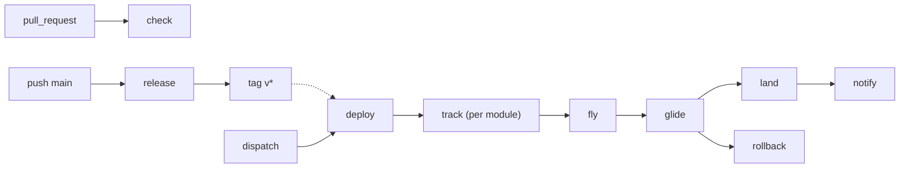

# pipelines

GitHub Actions pipelines for repositories made of **modules**. Each module is a
deployable unit with a code side and a deploy side; each side is a directory of
shell scripts. Nothing here knows your language, your cloud or your image names:
that is data from `.github/modules.json`, scripts from the module, and
credentials from the project's own setup action.

```
modules/main/
  code/ci/    lint.sh · test.sh · package.sh     → code subtrack
  deploy/ci/  check.sh · plan.sh                 → infra subtrack (pull request)
              fly.sh · glide.sh · rollback.sh    → deploy track
```

## What runs when

| event | workflow | what happens |
|---|---|---|
| `pull_request` | `check.yml` | code steps of touched modules + `check`/`plan` of touched deploy dirs |
| push main | `release.yml` | code steps, `package`, then an annotated tag listing the modules |
| tag push / dispatch | `deploy.yml` | one track per module carried by the tag |



Staging and production are the same `deploy.yml`; the environment is the only
parameter, and it resolves the environment `url` from the registry.

## Workflows

| file | level | role |
|---|---|---|
| `check.yml` | entrypoint | two matrices, code and infra, with a `changed` leg per module |
| `subtrack.yml` | reusable | one directory, one step per script; project setup; package |
| `release.yml` | entrypoint | detect → tag → code + package → stamped tag |
| `deploy.yml` | entrypoint | resolve the tag's modules → fan-out per module |
| `track.yml` | reusable | fly → glide → land → notify, rollback on failure |
| `self.yml` | — | this repository checks itself |

## Wiring a repository

Four thin entrypoints, one registry, one script per step you actually have.

```yaml
# .github/workflows/pr.yml
name: pr
on: { pull_request: }
permissions: { contents: read, id-token: write }
jobs:
  check:
    uses: br4zz4/pipelines/.github/workflows/check.yml@v1
    secrets:
      RUNTIME_CONFIG: ${{ secrets.RUNTIME_CONFIG }}
```

```yaml
# .github/workflows/main.yml
name: main
on: { push: { branches: [ main ] } }
permissions: { contents: write, id-token: write }
jobs:
  release:
    uses: br4zz4/pipelines/.github/workflows/release.yml@v1
    secrets:
      GH_TAG_TOKEN: ${{ secrets.GH_TAG_TOKEN }}
      RUNTIME_CONFIG: ${{ secrets.RUNTIME_CONFIG }}
```

```yaml
# .github/workflows/deploy-staging.yml
name: deploy-staging
on:
  push: { tags: [ 'v*' ] }
  workflow_dispatch:
    inputs:
      tag: { type: string, default: '' }
permissions: { contents: read, id-token: write, deployments: write }
jobs:
  deploy:
    uses: br4zz4/pipelines/.github/workflows/deploy.yml@v1
    with:
      environment: staging
      tag: ${{ github.event_name == 'push' && github.ref_name || inputs.tag }}
    secrets:
      RUNTIME_CONFIG: ${{ secrets.RUNTIME_CONFIG }}
      NOTIFY_WEBHOOK_URL: ${{ secrets.NOTIFY_WEBHOOK_URL }}
```

```yaml
# .github/workflows/deploy-production.yml
name: deploy-production
on:
  workflow_dispatch:
    inputs:
      tag:     { type: string, default: '' }
      modules: { type: string, default: '' }
permissions: { contents: read, id-token: write, deployments: write }
jobs:
  deploy:
    uses: br4zz4/pipelines/.github/workflows/deploy.yml@v1
    with:
      environment: production
      tag: ${{ inputs.tag }}
      modules: ${{ inputs.modules }}
    secrets:
      RUNTIME_CONFIG: ${{ secrets.RUNTIME_CONFIG }}
      NOTIFY_WEBHOOK_URL: ${{ secrets.NOTIFY_WEBHOOK_URL }}
```

An empty `tag` on production resolves the newest release recorded green in that
environment, so promotion starts from what already passed in staging.

## Contract

- **Registry is data.** `.github/modules.json` maps module names to a `code`
  directory, a `deploy` directory and per-environment `url`s. Everything else is
  derived.
- **Steps are scripts.** `<dir>/ci/<step>.sh` is a step. The code subtrack runs
  every script except `setup` and `package`; the infra subtrack runs `check` and
  `plan`; the deploy track runs `fly`, `glide` and `rollback`. Adding a step is
  adding a script.
- **The project owns the toolchain and the auth.** `.github/actions/setup` is a
  composite action in the project, called after checkout with `dir`,
  `environment` and `runtime-config`. `RUNTIME_CONFIG` is an opaque JSON secret:
  the pipeline forwards it, never parses it. `NOTIFY_WEBHOOK_URL` is optional.
- **The tag carries the release.** `git tag -a` with a `tracks:` line listing
  the modules; the deploy reads it instead of recomputing the diff. A
  lightweight tag (no message) carries every module.
- **No language and no platform in the pipeline.** Provider calls live in the
  module scripts — the examples show Cloud Run and Kubernetes. `tasks/check.py`
  fails the build if a provider name appears in a workflow or action.
- **Failure is explicit.** `rollback` only runs when `fly` or `glide` failed, and
  the module's script fails high when `ROLLBACK_POINT` is empty. `land` and
  `notify` only run after a successful glide.
- **`tmp/artifacts`** under the code directory is uploaded on a failed glide.
- **Examples are static.** `examples/` is documentation; copy what you need.

See [docs/contract.md](docs/contract.md) for the registry, the tag format, the
secrets, the matrices and the edge cases.

## Requirements

`ubuntu-24.04`, `python3`, `git` and `gh` are all the pipeline itself needs.
Anything else — a language runtime, `terraform`, `kubectl`, docker — belongs to
the project's scripts and setup action.
