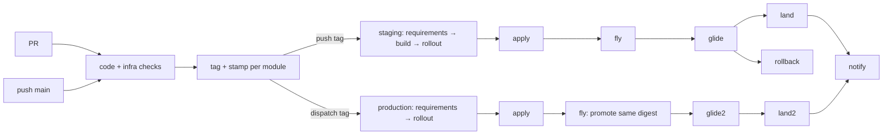

# pipelines

GitHub Actions pipelines for repositories made of **modules**. Each module is a
deployable unit with a code side and an infra side; each side is a directory of
shell scripts, and each module owns its own release tag. Nothing here knows your
language, your cloud or your image names: that is data from
`.github/modules.json`, scripts from the module, and credentials from the
project's own setup action.

```
modules/main/
  code/ci/    lint.sh · test.sh · build.sh              → code subtrack
  infra/ci/   check.sh · prepare.sh                     → infra subtrack (read-only gate)
              apply.sh · fly.sh · glide.sh · rollback.sh → rollout
```

Every job is named `<context> / <name>` — `check / main`, `prepare / main`,
`lint / main`, `apply / main`, `fly / main` — and every job step is named after
its script (`build`, `fly`, `glide`). The context sits at the root of the run;
the step only says what it runs.

## What runs when

| event | workflow | what happens |
|---|---|---|
| pull request | project + `subtrack.yml` | changed modules, `code` steps and `infra` check/prepare; no build, no tag |
| push main | project + `detect` | changed modules, same checks, one tag per affected module |
| push tag | `staging.yml` | `requirements` → `build` → `rollout` (staging) |
| dispatch a ref | `production.yml` | `requirements` → `rollout` (production); ref decides, **no build** |

The tag is the order to stage: pushing it triggers staging, and staging builds
the image. Production is a dispatch of that same tag, from its ref, and promotes
the image already built — the production entrypoint declares no `build` job.



A release tag is per module: `<module>.YYYY-MM-DD.NNN`, for example
`core.2026-11-13.001`. The module is the tag prefix, `${TAG%%.*}`, so the tag
alone tells the pipeline what to build, apply and deploy. The jobs that follow
`requirements` take the module from its output instead of deriving it again.

## Workflows

| file | level | role |
|---|---|---|
| `subtrack.yml` | reusable | one directory, one step per `ci/*.sh`; project setup; no build |
| `prepare.yml` | reusable | the read-only `prepare` hook of one module; the gate on PR/main |
| `build.yml` | reusable | the `build` hook of one module; the image of a release |
| `requirements.yml` | reusable | the releases matrix of the ref (module + tag per leg) |
| `rollout.yml` | reusable | `apply` → `fly` → `glide` → `land` → `notify`, rollback on failure |
| `self.yml` | — | this repository checks itself |

## Wiring a repository

A registry, one script per step you actually have, and four thin entrypoints.
The toolchain and the authentication live in `.github/actions/setup`, which the
project owns and the pipelines call after checkout.

```json
// .github/modules.json
{
  "shared": [".github/", ".project/", "Makefile", "compose.yml"],
  "modules": { "main": {}, "checkout": {} }
}
```

```yaml
# .github/workflows/pr.yml — checks only, no build
name: pr
on:
  pull_request:
permissions:
  contents: read
  id-token: write
jobs:
  detect:
    runs-on: blacksmith-2vcpu-ubuntu-2404
    outputs:
      code: ${{ steps.detect.outputs.code }}
      infra: ${{ steps.detect.outputs.infra }}
    steps:
      - uses: actions/checkout@v6
        with:
          fetch-depth: 0
      - id: detect
        uses: br4zz4/pipelines/actions/detect@v1
  code:
    needs: detect
    strategy:
      fail-fast: false
      matrix: ${{ fromJSON(needs.detect.outputs.code) }}
    uses: br4zz4/pipelines/.github/workflows/subtrack.yml@v1
    with:
      module: ${{ matrix.module }}
      dir: ${{ matrix.dir }}
      changed: ${{ matrix.changed }}
      steps_matrix: ${{ matrix.steps_matrix }}
    secrets:
      RUNTIME_CONFIG: ${{ secrets.RUNTIME_CONFIG }}
  infra:
    needs: detect
    strategy:
      fail-fast: false
      matrix: ${{ fromJSON(needs.detect.outputs.infra) }}
    uses: br4zz4/pipelines/.github/workflows/subtrack.yml@v1
    with:
      module: ${{ matrix.module }}
      dir: ${{ matrix.dir }}
      changed: ${{ matrix.changed }}
      steps_matrix: ${{ matrix.steps_matrix }}
    secrets:
      RUNTIME_CONFIG: ${{ secrets.RUNTIME_CONFIG }}
```

```yaml
# .github/workflows/main.yml — checks, then one tag per affected module
name: main
on:
  push:
    branches: [ main ]
permissions:
  contents: write
  id-token: write
jobs:
  detect:
    # same detect as pr.yml, plus the `modules` matrix and `<module>_code|_infra`
  code:
    # subtrack.yml for the code matrix of detect
  prepare:
    # prepare.yml@v1 for each changed module's infra dir (the gate)
  tag:
    needs: [ detect, code, prepare ]
    if: needs.detect.outputs.any == 'true'
    strategy:
      fail-fast: false
      matrix: ${{ fromJSON(needs.detect.outputs.modules) }}
    runs-on: blacksmith-2vcpu-ubuntu-2404
    steps:
      - uses: actions/checkout@v6
        with:
          fetch-depth: 0
          persist-credentials: false
      - id: tag
        uses: br4zz4/pipelines/actions/tag@v1
        with:
          prefix: ${{ matrix.module }}
      - uses: br4zz4/pipelines/actions/stamp@v1
        with:
          tag: ${{ steps.tag.outputs.tag }}
          token: ${{ secrets.GH_TAG_TOKEN }}
```

```yaml
# .github/workflows/staging.yml — the tag is the order to stage
name: staging
on:
  push:
    tags: [ 'main.*', 'checkout.*' ]
permissions:
  contents: read
  id-token: write
  deployments: write
jobs:
  requirements:
    uses: br4zz4/pipelines/.github/workflows/requirements.yml@v1
    with:
      environment: staging
  build:
    needs: requirements
    strategy:
      fail-fast: false
      matrix: ${{ fromJSON(needs.requirements.outputs.releases) }}
    uses: br4zz4/pipelines/.github/workflows/build.yml@v1
    with:
      module: ${{ matrix.module }}
      tag: ${{ matrix.tag }}
      environment: staging
    secrets:
      RUNTIME_CONFIG: ${{ secrets.RUNTIME_CONFIG }}
  rollout:
    needs: [ requirements, build ]
    strategy:
      fail-fast: false
      matrix: ${{ fromJSON(needs.requirements.outputs.releases) }}
    uses: br4zz4/pipelines/.github/workflows/rollout.yml@v1
    with:
      module: ${{ matrix.module }}
      tag: ${{ matrix.tag }}
      environment: staging
    secrets:
      RUNTIME_CONFIG: ${{ secrets.RUNTIME_CONFIG }}
      NOTIFY_WEBHOOK_URL: ${{ secrets.NOTIFY_WEBHOOK_URL }}
```

```yaml
# .github/workflows/production.yml — dispatch with no inputs; the ref decides, no build
name: production
on:
  workflow_dispatch:
permissions:
  contents: read
  id-token: write
  deployments: write
jobs:
  requirements:
    uses: br4zz4/pipelines/.github/workflows/requirements.yml@v1
    with:
      environment: production
  rollout:
    needs: requirements
    strategy:
      fail-fast: false
      matrix: ${{ fromJSON(needs.requirements.outputs.releases) }}
    uses: br4zz4/pipelines/.github/workflows/rollout.yml@v1
    with:
      module: ${{ matrix.module }}
      tag: ${{ matrix.tag }}
      environment: production
    secrets:
      RUNTIME_CONFIG: ${{ secrets.RUNTIME_CONFIG }}
      NOTIFY_WEBHOOK_URL: ${{ secrets.NOTIFY_WEBHOOK_URL }}
```

Dispatch from a branch (`gh workflow run production.yml --ref main`): every
release tag pointing at that commit gets a rollout leg. Dispatch from a tag
(`... --ref <module>.2026-11-13.001`): exactly that release. There are no inputs —
each leg's rollout proves the tag points at the commit of the run and that
staging recorded it green for that module.

## Contract

- **Folders are convention.** `modules/<name>/code` and `modules/<name>/infra`;
  the registry only declares `shared` and the per-module `code.dir` /
  `infra.dir` when they differ from the default.
- **Tags are per module.** `<module>.YYYY-MM-DD.NNN`, annotated, one per module
  and per day. The module is the prefix: `${TAG%%.*}`.
- **Steps are scripts.** `<dir>/ci/<step>.sh` is a step. The code subtrack runs
  every script except `setup` and `build`; the infra subtrack runs `check` and
  `prepare`; the rollout runs `apply`, `fly`, `glide` and `rollback`.
- **Tag = staging order.** Pushing the tag runs `requirements → build →
  rollout`; staging builds the image and applies it.
- **Production promotes, never builds.** `production.yml` declares only
  `requirements` and `rollout`; `fly` promotes the same digest that staging
  built. There is no `build` job to run.
- **`prepare` is a gate, `rollout` never plans.** `prepare` is read-only and
  runs on PR/main; the tag only exists after it passes. In the rollout, `apply`
  is the only job that changes infrastructure.
- **The project owns the toolchain and the auth.** `.github/actions/setup` is a
  composite action in the project, called after checkout with `dir`,
  `environment` and `runtime-config`. `RUNTIME_CONFIG` is an opaque JSON secret:
  the pipeline forwards it, never parses it. `NOTIFY_WEBHOOK_URL` is optional.
  `GH_TAG_TOKEN` is the PAT with the `workflow` scope that pushes the tag.
- **The url comes from glide.** `glide` writes `url=<url>` to `$GITHUB_OUTPUT`;
  `land` records it as `environment_url` and `notify` prints it. The registry
  has no url.
- **No language and no platform in the pipeline.** Provider calls live in the
  module scripts — the examples show Cloud Run and Kubernetes. `tasks/check.py`
  fails the build if a provider name appears in a workflow or action.
- **Failure is explicit.** `rollback` only runs when `fly` or `glide` failed,
  and the module's script fails high when `ROLLBACK_POINT` is empty. A failed
  `apply` does not roll back: nothing went live yet, so it asks for a human.
  `land` and `notify` only run after a successful glide.
- **`tmp/artifacts`** under the code directory is uploaded on a failed glide.
- **Examples are static.** `examples/` is documentation; copy what you need.
- **Everything references `@v1`.** The published tag is `v1`; internal `uses:`
  are absolute (`br4zz4/pipelines/...@v1`), except `./.github/actions/setup`,
  which must resolve in the project.

See [docs/contract.md](docs/contract.md) for the registry, the tag format, the
secrets, the matrices and the edge cases.

## Requirements

`blacksmith-*` runners, `python3`, `git` and `gh` are all the pipeline itself needs.
Anything else — a language runtime, `terraform`, `kubectl`, docker — belongs to
the project's scripts and setup action.
