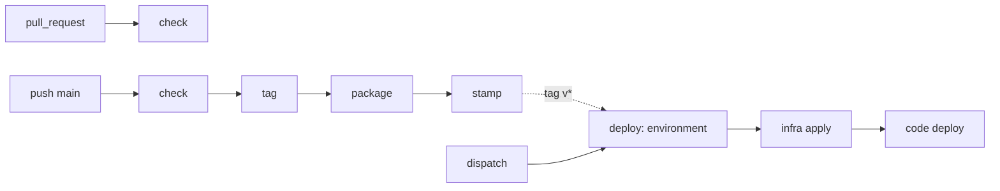

# pipelines

GitHub Actions pipelines for repositories made of **modules**. Each module is a
track. A track has facets — `code` and `infra` — and each facet is its own
pipeline. Nothing here knows your language, your cloud layout or your image
names: that is data, read from `.github/modules.json` of the calling repository,
and scripts, taken from the module's own `ci/` directory.

```
trilha  modules/main/            ╭─ subtrilha code   modules/main/code   → lint · test · package
        modules/checkout/        ╰─ subtrilha infra  modules/main/deploy → check · plan · apply
```

## What runs when

| event | workflow | tracks |
|---|---|---|
| `pull_request` | `check.yml` | touched facets: steps + fmt/validate + read-only plan |
| push main | `main.yml` | touched facets: steps + build/push image → stamped annotated tag |
| tag push / dispatch | `deploy.yml` | facets listed by the tag: infra apply → code deploy |
| dispatch | `deploy.yml` | same, with `environment: production` |



`staging` and `production` are the same `deploy.yml`. The only difference is the
environment name, which resolves image source, prefix and URL from the registry.

## Workflows

| file | level | role |
|---|---|---|
| `check.yml` | entrypoint | fan-out of both facets of every touched module |
| `code.yml` | module | the code facet: steps from `<code_dir>/ci/*.sh` + image build |
| `infra.yml` | module | the infra facet: fmt/validate, plan, apply |
| `main.yml` | entrypoint | detect → tag → build → stamp |
| `deploy.yml` | entrypoint | resolve the tag's tracks → fan-out per module |
| `module.yml` | module | infra → code, in order, for one module |
| `line.yml` | module | the deploy line: ship · smoke · e2e · record · notify · rollback |

## Wiring a repository

Four thin entrypoints, one registry, one script per step you actually have.

```yaml
# .github/workflows/pr.yml
name: pr
on: { pull_request: }
permissions: { contents: read, id-token: write }
concurrency: { group: pr-${{ github.ref }}, cancel-in-progress: true }
jobs:
  check:
    uses: br4zz4/pipelines/.github/workflows/check.yml@v1
    secrets:
      GCP_WIF_PROVIDER: ${{ secrets.GCP_STAGING_WIF_PROVIDER }}
      GCP_DEPLOY_SA: ${{ secrets.GCP_STAGING_DEPLOY_SA }}
```

```yaml
# .github/workflows/main.yml
name: main
on: { push: { branches: [ main ] } }
permissions: { contents: write, id-token: write }
concurrency: { group: main-release, cancel-in-progress: false }
jobs:
  release:
    uses: br4zz4/pipelines/.github/workflows/main.yml@v1
    secrets:
      GH_TAG_TOKEN: ${{ secrets.GH_TAG_TOKEN }}
      GCP_WIF_PROVIDER: ${{ secrets.GCP_STAGING_WIF_PROVIDER }}
      GCP_DEPLOY_SA: ${{ secrets.GCP_STAGING_DEPLOY_SA }}
```

```yaml
# .github/workflows/deploy-staging.yml
name: deploy-staging
on:
  push: { tags: [ 'v*' ] }
  workflow_dispatch:
    inputs:
      tag: { required: true, type: string }
permissions: { contents: read, id-token: write, deployments: write }
concurrency: { group: deploy-staging, cancel-in-progress: false }
jobs:
  deploy:
    uses: br4zz4/pipelines/.github/workflows/deploy.yml@v1
    with:
      environment: staging
      tag: ${{ github.event_name == 'push' && github.ref_name || inputs.tag }}
    secrets:
      GCP_WIF_PROVIDER: ${{ secrets.GCP_STAGING_WIF_PROVIDER }}
      GCP_DEPLOY_SA: ${{ secrets.GCP_STAGING_DEPLOY_SA }}
      GCP_SOURCE_WIF_PROVIDER: ${{ secrets.GCP_STAGING_WIF_PROVIDER }}
      GCP_SOURCE_DEPLOY_SA: ${{ secrets.GCP_STAGING_DEPLOY_SA }}
      NOTIFY_WEBHOOK_URL: ${{ secrets.NOTIFY_WEBHOOK_URL }}
```

```yaml
# .github/workflows/deploy-production.yml
name: deploy-production
on:
  workflow_dispatch:
    inputs:
      tag:     { required: false, type: string, default: '' }
      modules: { required: false, type: string, default: '' }
permissions: { contents: read, id-token: write, deployments: write }
concurrency: { group: deploy-production, cancel-in-progress: false }
jobs:
  deploy:
    uses: br4zz4/pipelines/.github/workflows/deploy.yml@v1
    with:
      environment: production
      tag: ${{ inputs.tag }}
      modules: ${{ inputs.modules }}
    secrets:
      GCP_WIF_PROVIDER: ${{ secrets.GCP_PRODUCTION_WIF_PROVIDER }}
      GCP_DEPLOY_SA: ${{ secrets.GCP_PRODUCTION_DEPLOY_SA }}
      GCP_SOURCE_WIF_PROVIDER: ${{ secrets.GCP_STAGING_WIF_PROVIDER }}
      GCP_SOURCE_DEPLOY_SA: ${{ secrets.GCP_STAGING_DEPLOY_SA }}
      NOTIFY_WEBHOOK_URL: ${{ secrets.NOTIFY_WEBHOOK_URL }}
```

## Contract

- **Tracks come from the diff.** `modules/<name>/code/**` is `<name>/code`;
  `modules/<name>/deploy/**` is `<name>/infra`. Shared paths (`.github/`,
  `tasks/`, `.project/`, `Makefile`, `compose.yml`) count for every track.
  Docs never trigger anything. A manual run counts as everything.
- **The tag carries the release.** `git tag -a` with a `tracks:` line; the
  deploy reads it instead of recomputing the diff. A lightweight tag (no
  message) is accepted as "all tracks", so old releases stay deployable.
- **Steps are scripts.** `<facet_dir>/ci/<step>.sh` is a step. The toolchain
  is `.github/actions/setup`, a composite action of the project, called before
  every step when present.
- **Generic calls the specific.** Every action checks
  `modules/<name>/deploy/ci/<step>.sh` before doing its default work, and runs
  it instead when present.
- **No project path in a workflow.** All module knowledge is `modules.json`.

See [docs/contract.md](docs/contract.md) for the registry schema, the tag
format, the secrets and the edge cases.

## Requirements

`ubuntu-24.04`, `python3`, `git`, `gh`, `gcloud`, `terraform` (version read from
the repository's `.terraform-version`), `docker`.
