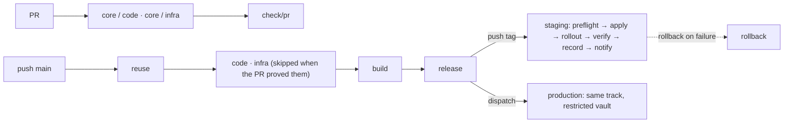

# pipelines

One pipeline for every project, whatever its language and whatever its cloud.
A repository declares its **modules**; this repository checks, builds, tags and
deploys each module on its own track, and **generates and verifies** the
workflows so no project can drift from the standard.

Nothing here knows a language or a provider: that is data from
`.github/modules.json`, the toolchain a module's `mise.toml` declares, the
scripts of its `ci/` directories and the secrets of its ward vaults. Heroku,
Cloud Run, Kubernetes and ECS Fargate all fit the same eight hooks
([examples/](examples/README.md)).

```
modules/core/
  code/   mise.toml · ci/{lint,audit,test,build}.sh
  infra/  mise.toml · ci/{validate,plan,apply,deploy,verify,rollback}.sh
```

## What runs when

A project has exactly three workflows, **generated** from its registry:

| event | workflow | what happens |
|---|---|---|
| pull request | `pr.yml` | `conform` → `detect` → per changed module and side: `code` (`lint · audit · test`) and `infra` (`validate · plan`) → `check/pr` |
| push main | `main.yml` | `conform` → `detect` → per changed module: `reuse` → `code` and `infra` (what the pull request did not prove) → `build` → `release` |
| push tag | `deploy.yml` | staging: `preflight → apply → rollout → verify → record → notify` (`rollback` on failure) |
| dispatch | `deploy.yml` | production: the same track, on the ref; **never builds** |

Every module is a **track** of parallel, independent jobs: a failing module
never stops another one. No job fans out through a strategy: every module and every step is a literal job. The graph reads
`<module> / <job>`: `core / check / test`, `gateway / build`, `core / rollout`.



- **The tag exists only if the image does.** `build` computes the next name
  `<module>.YYYY-MM-DD.NNN` and builds the image under it (the hook receives it as `TAG`);
  `release` publishes it only after the build succeeded. Pushing the tag is the order to deploy
  staging.
- **Staging and production are the same track.** Only `environment` differs, and
  the event decides it. Production never builds: it raises what staging recorded
  green (`record`).
- **`main` reuses what the pull request proved.** A check is skipped only when
  the merged pull request was green on it and tested exactly the content that  was merged.
- **`check/pr` is the only check a ruleset needs.** It always runs and sums up
  every other job; a pull request that touches no module still reports it.

## Adopting it

1. `.github/modules.json` — the registry:

   ```json
   {
     "shared": [".github/", ".ward/", "Makefile"],
     "extra_workflows": [],
     "modules": {
       "core":    { "services": ["postgres"] },
       "gateway": {}
     }
   }
   ```

2. Per module and per side: the `mise.toml` and the hooks of the vocabulary.
   **Every hook is mandatory**; a module with nothing to do keeps a script that
   prints why and exits 0. The hook is the implementation; `make core.test` from `br4zz4/commons` runs the same hook locally.
3. `.github/actions/setup/action.yml` — authentication only (see
   [examples/](examples/README.md)).
4. Ward: the vaults `<project>` (test, staging and the pipeline's own
   `secrets.ci`) and `<project>::restricted` (production), committed encrypted.
   GitHub holds only `WARD_KEY_<PROJECT>` and `WARD_KEY_<PROJECT>_RESTRICTED`.
5. Generate the workflows once, by hand, and commit them with the rest:
   `python3 actions/conform/render.py --root .` (a pull request runs the workflows
   of its own branch, so the first ones must come with it). From then on
   `conform` keeps them in sync: when the registry changes it regenerates and
   commits them to the branch (`ci: render workflows`) and the next run is the
   real one.
6. Protect `main` with a ruleset that requires one status check: `check/pr`
   (GitHub Actions integration, id `15368`; `strict: true`, branch up to date). Create it **after** the first
   generated `pr.yml` is on `main`, or every pull request waits for a check that
   never reports.

Run the generator by hand with
`python3 actions/conform/render.py --root <project> [--ref v1]`: `--ref` is the tag of this
repository the workflows call, and `conform` passes the tag it was itself called with.
The `::restricted` vault is optional until a project has production secrets; without it a
production dispatch stops in `preflight` asking for the restricted key.

A pre-release tag is cut with `sh tasks/release.sh <name> --push`: it is a
commit with every internal reference rewritten to the tag, so a consumer on the pre-release
never reaches code of `v1`.

## Enforcement

`conform` is the first job of every run. It regenerates the workflows from the
registry and fails when:

- a generated workflow differs from the render;
- `.github/workflows/` holds a file that is not `pr`, `main` or `deploy` and is
  not listed in `extra_workflows`;
- a restricted ward key is mentioned anywhere but `deploy.yml`;
- a module lacks a hook of the vocabulary, has a script outside it, or has no
  `mise.toml`;
- `.github/actions/setup/action.yml` is missing;
- the ward config lacks a default vault and its `::restricted` pair, or a module
  asks for a service outside `postgres` and `redis`.

On a pull request from the same repository it fixes the workflows and commits;
everywhere else it only reports.

## Workflows of this repository

| file | level | role |
|---|---|---|
| `code.yml` | reusable | `lint`, `audit` and `test` of one module's code side, in parallel |
| `infra.yml` | reusable | `validate` and `plan` of one module's infra side, in parallel |
| `deploy.yml` | reusable | the deploy track of one release in one environment |
| `self.yml` | — | this repository checks itself |

Actions: `conform` (and `render.py`), `detect`, `releases`, `reuse`, `step`
(secrets → toolchain → cache → setup → hook), `hook`, `tag` (next name), `stamp` (publish the release tag),
`requirements`, `resolve`, `record`, `notify`, `gate`.

## Requirements

`blacksmith-*` runners, `python3`, `git` and `gh` are all the pipeline itself
needs, plus `br4zz4/setup-ward` for the secrets and `mise` for the toolchain.
Anything else — a language, a cloud CLI, docker — belongs to the module's
`mise.toml` and scripts.

See [docs/contract.md](docs/contract.md) for the registry, the vocabulary, the
secrets, the tags and the edge cases, and [docs/CONTEXT.md](docs/CONTEXT.md) for
the glossary.
