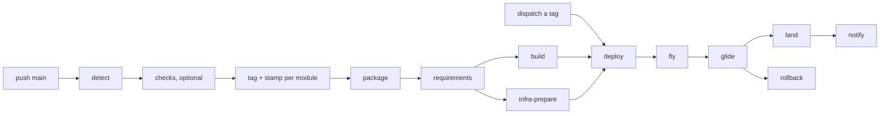

# pipelines

GitHub Actions pipelines for repositories made of **modules**. Each module is a
deployable unit with a code side and an infra side; each side is a directory of
shell scripts, and each module owns its own release tag. Nothing here knows your
language, your cloud or your image names: that is data from
`.github/modules.json`, scripts from the module, and credentials from the
project's own setup action.

```
modules/main/
  code/ci/    lint.sh · test.sh · package.sh            → code subtrack
  infra/ci/   check.sh · infra-prepare.sh               → infra subtrack (read-only)
              fly.sh · glide.sh · rollback.sh           → deploy track
```

Every job is named `<context> / <name>` — `build / main`, `infra-prepare / main`,
`lint / main`, `fly / main` — so a matrix stays readable.

## What runs when

| event | workflow | what happens |
|---|---|---|
| push main | project + `detect` | changed modules, optional checks, one tag per module |
| push tag | `package.yml` | `requirements` → `build` ∥ `infra-prepare` → `deploy` (staging) |
| dispatch a tag | `deploy.yml` | production; no tag promotes the newest release green in staging |



A release tag is per module: `<module>.YYYY.MM.DD.N`, for example
`main.2026.11.12.3`. The module is the tag prefix, `${TAG%%.*}`, so the tag
alone tells the pipeline what to build, plan and deploy.

## Workflows

| file | level | role |
|---|---|---|
| `subtrack.yml` | reusable | one directory, one step per `ci/*.sh`; project setup; no package |
| `infra-prepare.yml` | reusable | the read-only `infra-prepare` hook of one module |
| `package.yml` | entrypoint | requirements → build ∥ infra-prepare → deploy |
| `deploy.yml` | reusable | requirements → fly → glide → land → notify, rollback on failure |
| `self.yml` | — | this repository checks itself |

## Wiring a repository

Three thin entrypoints, one registry, one script per step you actually have.
The toolchain and the authentication live in `.github/actions/setup`, which the
project owns and the pipelines call after checkout.

```yaml
# .github/workflows/main.yml
name: main
on:
  push:
    branches: [ main ]
permissions:
  contents: write
  id-token: write
jobs:
  detect:
    runs-on: ubuntu-24.04
    outputs:
      code: ${{ steps.detect.outputs.code }}
      infra: ${{ steps.detect.outputs.infra }}
      modules: ${{ steps.detect.outputs.modules }}
      any: ${{ steps.detect.outputs.any }}
    steps:
      - uses: actions/checkout@v6
        with:
          fetch-depth: 0
      - id: detect
        uses: br4zz4/pipelines/actions/detect@v1
  code:
    needs: detect
    strategy:
      fail-fast: false
      matrix: ${{ fromJSON(needs.detect.outputs.code) }}
    uses: br4zz4/pipelines/.github/workflows/subtrack.yml@v1
    with:
      module: ${{ matrix.module }}
      dir: ${{ matrix.dir }}
      changed: ${{ matrix.changed }}
      steps_matrix: ${{ matrix.steps_matrix }}
    secrets:
      RUNTIME_CONFIG: ${{ secrets.RUNTIME_CONFIG }}
  infra:
    needs: detect
    strategy:
      fail-fast: false
      matrix: ${{ fromJSON(needs.detect.outputs.infra) }}
    uses: br4zz4/pipelines/.github/workflows/subtrack.yml@v1
    with:
      module: ${{ matrix.module }}
      dir: ${{ matrix.dir }}
      changed: ${{ matrix.changed }}
      steps_matrix: ${{ matrix.steps_matrix }}
    secrets:
      RUNTIME_CONFIG: ${{ secrets.RUNTIME_CONFIG }}
  tag:
    needs: [ detect, code, infra ]
    if: needs.detect.outputs.any == 'true'
    strategy:
      fail-fast: false
      matrix: ${{ fromJSON(needs.detect.outputs.modules) }}
    runs-on: ubuntu-24.04
    steps:
      - uses: actions/checkout@v6
        with:
          fetch-depth: 0
          persist-credentials: false
      - id: tag
        uses: br4zz4/pipelines/actions/tag@v1
        with:
          prefix: ${{ matrix.module }}
      - uses: br4zz4/pipelines/actions/stamp@v1
        with:
          tag: ${{ steps.tag.outputs.tag }}
          token: ${{ secrets.GH_TAG_TOKEN }}
```

```yaml
# .github/workflows/staging.yml
name: staging
on:
  push:
    tags: [ '*.*.*.*' ]
permissions:
  contents: read
  id-token: write
  deployments: write
jobs:
  package:
    uses: br4zz4/pipelines/.github/workflows/package.yml@v1
    with:
      tag: ${{ github.ref_name }}
    secrets:
      RUNTIME_CONFIG: ${{ secrets.RUNTIME_CONFIG }}
```

```yaml
# .github/workflows/production.yml
name: production
on:
  workflow_dispatch:
    inputs:
      module:
        description: Module to promote
        required: true
        type: string
      tag:
        description: Release tag. Empty promotes the newest release green in staging.
        required: false
        type: string
        default: ''
permissions:
  contents: read
  id-token: write
  deployments: write
jobs:
  deploy:
    uses: br4zz4/pipelines/.github/workflows/deploy.yml@v1
    with:
      environment: production
      module: ${{ inputs.module }}
      tag: ${{ inputs.tag }}
    secrets:
      RUNTIME_CONFIG: ${{ secrets.RUNTIME_CONFIG }}
      NOTIFY_WEBHOOK_URL: ${{ secrets.NOTIFY_WEBHOOK_URL }}
```

Dispatch from the tag ref (`gh workflow run production.yml --ref <module>.2026.11.12.3`):
`requirements` proves the tag points at the commit of the run. An empty `tag`
asks `resolve` for the newest release recorded green in staging for that module,
so promotion starts from what already passed there.

## Contract

- **Folders are convention.** `modules/<name>/code` and `modules/<name>/infra`;
  the registry only declares `shared` and the per-module `code.dir` /
  `infra.dir` when they differ from the default.
- **Tags are per module.** `<module>.YYYY.MM.DD.N`, annotated, one per module
  and per day. The module is the prefix: `${TAG%%.*}`.
- **Steps are scripts.** `<dir>/ci/<step>.sh` is a step. The code subtrack runs
  every script except `setup` and `package`; the infra subtrack runs `check` and
  `infra-prepare`; the deploy track runs `fly`, `glide` and `rollback`.
- **`package` = build ∥ infra-prepare → deploy.** Both halves read the same tag
  and run at the same time; the prepare is read-only, so a plan never queues
  behind an image. When there is nothing to prepare, the script says so and
  succeeds — "nothing to apply" is a valid plan.
- **The project owns the toolchain and the auth.** `.github/actions/setup` is a
  composite action in the project, called after checkout with `dir`,
  `environment` and `runtime-config`. `RUNTIME_CONFIG` is an opaque JSON secret:
  the pipeline forwards it, never parses it. `NOTIFY_WEBHOOK_URL` is optional.
  `GH_TAG_TOKEN` is the PAT with the `workflow` scope that pushes the tag.
- **The tag carries the release.** No `tracks:` line, no registry lookup: the
  tag prefix is the module.
- **The url comes from glide.** `glide` writes `url=<url>` to `$GITHUB_OUTPUT`;
  `land` records it as `environment_url` and `notify` prints it. The registry
  has no url.
- **No language and no platform in the pipeline.** Provider calls live in the
  module scripts — the examples show Cloud Run and Kubernetes. `tasks/check.py`
  fails the build if a provider name appears in a workflow or action.
- **Failure is explicit.** `rollback` only runs when `fly` or `glide` failed,
  and the module's script fails high when `ROLLBACK_POINT` is empty. `land` and
  `notify` only run after a successful glide.
- **`tmp/artifacts`** under the code directory is uploaded on a failed glide.
- **Examples are static.** `examples/` is documentation; copy what you need.
- **Everything references `@v1`.** The published tag is `v1`; internal `uses:`
  are absolute (`br4zz4/pipelines/...@v1`), except `./.github/actions/setup`,
  which must resolve in the project.

See [docs/contract.md](docs/contract.md) for the registry, the tag format, the
secrets, the matrices and the edge cases.

## Requirements

`ubuntu-24.04`, `python3`, `git` and `gh` are all the pipeline itself needs.
Anything else — a language runtime, `terraform`, `kubectl`, docker — belongs to
the project's scripts and setup action.
